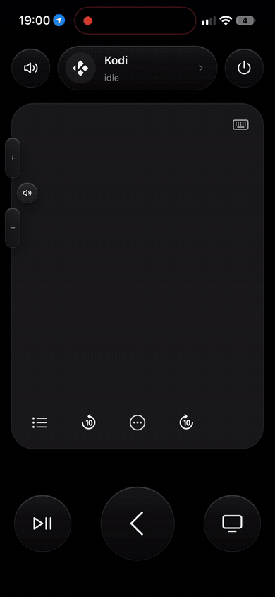
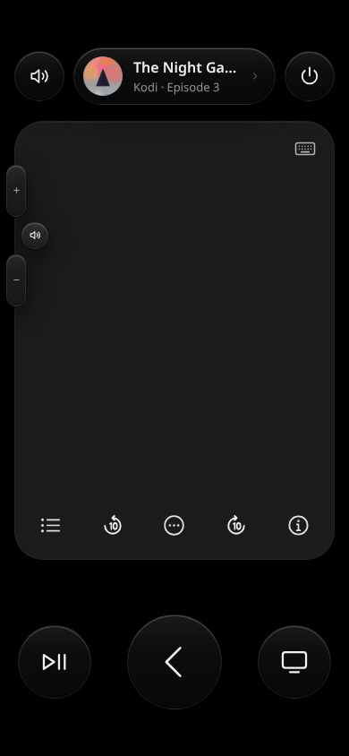
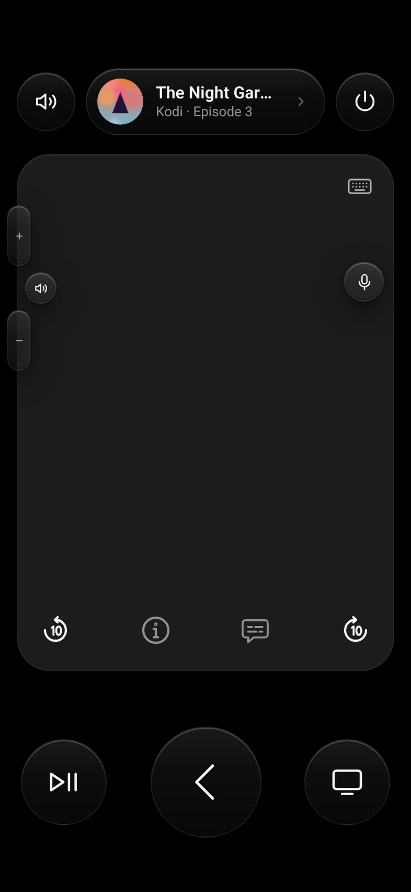
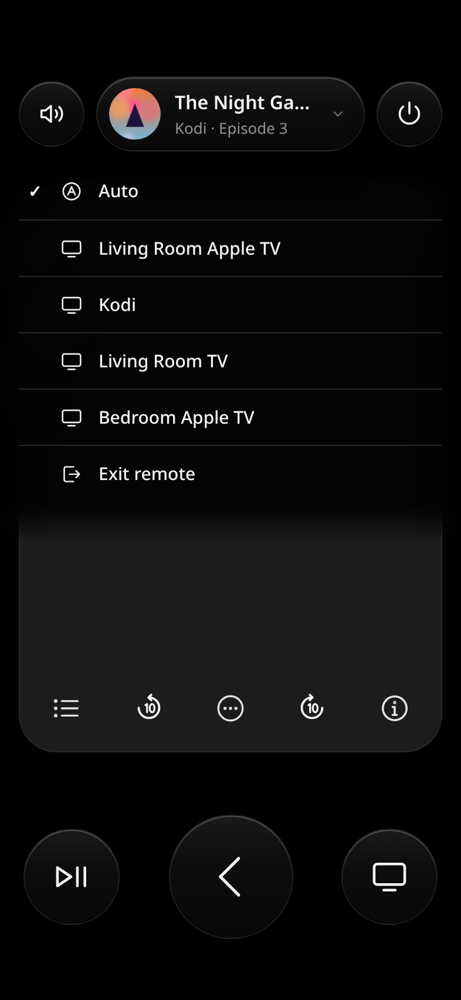
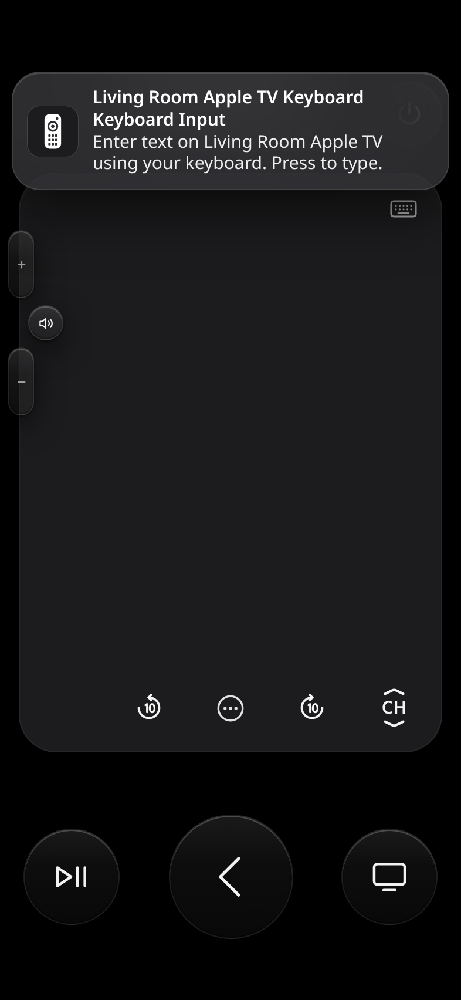
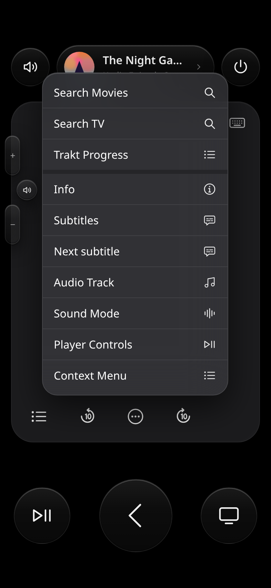
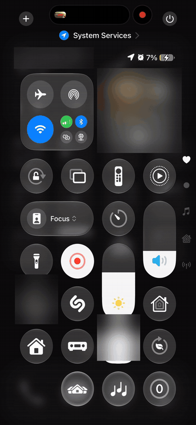

# Glass Remote Card

[](https://hacs.xyz/docs/faq/custom_repositories)
[](https://github.com/evski/ha-glass-remote-card/releases)
[](https://github.com/evski/ha-glass-remote-card/actions/workflows/test.yml)
[](https://github.com/evski/ha-glass-remote-card/actions/workflows/validate.yml)
[](LICENSE)

**A frosted-glass, touchpad remote for Home Assistant that follows whatever you're watching.**
One card drives Kodi, LG webOS TVs, devices from Home Assistant's Apple TV integration and any other `media_player`: touchpad, volume, keyboard and dictation, with the now-playing artwork on top. Built for the Home Assistant companion app on a phone, full screen, and it works in any browser.

<sub>Not affiliated with or endorsed by Apple Inc. Apple TV is a trademark of Apple Inc.</sub>

**Nothing else to install.** It's a single JavaScript file. You don't need any other custom cards, HACS add-ons or Home Assistant add-ons: no card-mod, browser_mod, kiosk-mode, template helpers or extra scripts. It only uses Home Assistant's built-in integrations for your devices: [Apple TV](https://www.home-assistant.io/integrations/apple_tv/), [Kodi](https://www.home-assistant.io/integrations/kodi/) and [LG webOS TV](https://www.home-assistant.io/integrations/webostv/). Any other `media_player` works through its standard services.

<table align="center"><tr>
<td align="center"><br><sub><b>On a real phone</b> (Kodi)</sub></td>
<td align="center"><br><sub>Demo with placeholder devices</sub></td>
</tr></table>

<p align="center">
  
  
  
</p>

## Features

- **Clean, phone-first design.** Frosted glass buttons, thin line icons and a big touchpad.
- **Full screen with safe areas.** The card fills the screen and respects the notch and home indicator on any phone. There's no hard-coded height. Use `layout: card` to place it inside a normal dashboard instead. On a tablet or other wide screen it keeps the phone's proportions in a centred column (see `column_ratio` and `max_width`).
- **Follows what you're watching.** Priority order:
  - A device you picked yourself, kept for a few hours.
  - Your TV's input, mapped to a player. An app running on the TV selects the TV itself.
  - Otherwise playing beats paused, which beats idle, and the most recent change wins.
- **Now-playing pill.** Shows artwork, title and `Device · episode/app/state`. Tap it to open the device picker, which is built in (no browser_mod).
- **Touchpad.** Swipe for arrows; keep holding after a swipe to keep moving. Tap to select, long-press for the context menu.
- **Buttons:**
  - A bottom row inside the pad: **sources list | -10 | ⋯ more | +10 | CH**. Tap **CH** to open the channel stack (up chevron, CH, down chevron). Tap CH again to close it, or it closes by itself after 5 s. CH only shows on devices with channel keys. On devices without them (Kodi by default), that slot is an **Info** (i) button instead, and Info is then left out of that device's More menu.
  - **Sources** opens a glass picker with the player's sources, or those of your receiver or TV. The current source is ticked.
  - **More (⋯)** holds info (unless the device has the Info button on the row), subtitles, sound mode and each platform's extras.
  - **Shortcuts** you define per player (an add-on search, a favourite list, a scene) appear as the first section of the More menu while that player is active. Search shortcuts ask for text in the typing sheet first. See [Shortcuts](#shortcuts).
  - Play/pause, a big Back button and Home underneath. Long-press Back for the top menu and Home for the platform's extra action.
- **Volume tabs on the pad's edge.** Holding a tab repeats. Press and hold the speaker badge between the tabs to pick the receiver's **sound mode**. Volume can go to a receiver, with a fallback when the receiver is off, or through the player's `remote` entity (HDMI-CEC/IR).
- **Keyboard and dictation.**
  - The keyboard button opens a text box (a separate mic button is available with `show_mic: true`). When the player can report keyboard focus (a `keyboard_sensor`, such as the one from the Apple TV integration, or Kodi's keyboard window seen by the poll), the text box only opens while a text field is selected. Otherwise a small glass hint says "No text field selected", and the box closes by itself when the field goes away. Players that can't report focus, like LG webOS, always open it.
  - If a text call fails, the card shows one glass hint instead of a stack of Home Assistant error toasts.
  - On a phone, tap the keyboard's mic key to dictate.
  - Text goes live to the Apple TV integration, LG webOS or Kodi. Kodi gets `Input.SendText` with `done: false` while you type and `done: true` on Enter, so it lands in an add-on's search box.
- **Keyboard notification.** When the player's keyboard-focus sensor turns on, a notification-style banner slides down: "*Living Room Keyboard* / *Keyboard Input* / Enter text on Living Room using your keyboard. Press to type." Tap it to type.
- **Input switching.** Before a key is sent, the card can put your AV receiver, soundbar or TV on the right input. By default this happens on Home. See [Input switching](#input-switching).
- **Haptics** in the Home Assistant companion apps.
- **Pairs with [Sidebar Mini Player](https://github.com/evski/ha-sidebar-mini-player).** Its remote button opens this card already set to that player.

## Supported devices

| `platform` | Integration | Arrows, select, back, home | Skip | Info / subtitles | Text | Power |
|---|---|---|---|---|---|---|
| `apple_tv` | [Apple TV](https://www.home-assistant.io/integrations/apple_tv/) (`remote.*` + `media_player.*`) | `remote.send_command` | ±10 s (skip_backward/forward) | Opens the device's info panel | Live, via `apple_tv.set_keyboard_text` (needs `config_entry_id`) | Wake / sleep |
| `kodi` | [Kodi](https://www.home-assistant.io/integrations/kodi/) | `kodi.call_method` Input.* | ±10 s (Player.Seek) | Input.Info / show subtitles (hold = next track) | `Input.SendText` on Enter | Kodi shutdown menu |
| `webostv` | [LG webOS TV](https://www.home-assistant.io/integrations/webostv/) | `webostv.button` | Rewind / fast-forward | INFO / CC | Live, via the IME (`webostv.command`) | On / off |
| `generic` | Any `media_player` (and optional `remote.*`) | Via `remote` if you set one | Previous / next track | Via `remote` | Your own `actions.text` | On / off |

Every button can be overridden per player with `actions:` (see below).

## Installation

### HACS (recommended)

1. HACS → ⋮ → **Custom repositories** → add `https://github.com/evski/ha-glass-remote-card` as **Dashboard**.
2. Install **Glass Remote Card**, then reload the browser. In the companion app, use **Settings → Companion App → Debugging → Reset frontend cache**.

### Manual

Copy `glass-remote-card.js` to `/config/www/`, then add a dashboard resource `/local/glass-remote-card.js` (type: JavaScript module).

## Quick start

Make a new dashboard (e.g. "Remote"). Add a view with **View type: Panel (single card)** and this card:

```yaml
type: custom:glass-remote-card
players:
  - entity: media_player.living_room_apple_tv
    platform: apple_tv
    remote: remote.living_room_apple_tv
  - entity: media_player.kodi
    platform: kodi
```

The card covers the whole screen, including the dashboard header. Its picker has an **Exit remote** entry that goes back to `exit_path`.

## Full example

```yaml
type: custom:glass-remote-card
layout: fullscreen          # or "card" to sit inside a normal dashboard
pick_timeout: 180           # minutes a manual pick is kept
players:
  - entity: media_player.living_room_apple_tv
    name: Living Room
    platform: apple_tv
    remote: remote.living_room_apple_tv
    config_entry_id: 01ABCDEF...          # enables typing (see below)
    keyboard_sensor: binary_sensor.living_room_apple_tv_keyboard_focus
    volume_entity: media_player.receiver  # volume + mute go here...
    volume_fallback: media_player.living_room_tv  # ...or here when the receiver is off
  - entity: media_player.kodi
    platform: kodi
    volume_entity: media_player.receiver
    volume_fallback: media_player.living_room_tv
  - entity: media_player.living_room_tv
    platform: webostv
    volume_entity: media_player.receiver
    volume_fallback: media_player.living_room_tv
  - entity: media_player.bedroom_apple_tv
    name: Bedroom
    platform: apple_tv
    remote: remote.bedroom_apple_tv
    volume_via_remote: true               # volume_up/down through the remote entity (CEC/IR); hides mute
source_map:                               # optional: follow the TV's input
  entity: media_player.living_room_tv
  sources:
    "Apple TV": media_player.living_room_apple_tv
    "Kodi": media_player.kodi
  ignore_sources: ["AV Receiver", "HDMI 1"]   # inputs that don't say who's playing
```

## Options

### Card

| Option | Default | Description |
|---|---|---|
| `players` | **required** | List of players (below). A plain entity id string also works. |
| `layout` | `fullscreen` | `fullscreen`: a fixed, full-viewport remote that respects safe areas. `card`: a normal card. |
| `pad_height` | `58dvh` | Touchpad height in full screen. It shrinks on small screens. |
| `column_ratio` | `0.52` | Tablets and other wide screens: the full-screen remote becomes a centred column this many times the screen height wide, and the touchpad fills the height. Phones aren't affected. |
| `max_width` | – | Caps that column's width, for example `560` or `560px`. |
| `show_mic` | `false` | Show a separate mic button on the pad. It opens the same text box as the keyboard button. |
| `channel_timeout` | `5000` | How long (ms) the open CH stack (up / CH / down) stays open without use before it folds back. `0` = never. |
| `card_height` | `640px` | Height of the whole card in `card` layout. |
| `pick_timeout` | `180` | Minutes a manual pick is kept before Auto takes over again. |
| `source_map` | – | `entity` (the TV), `sources` (input → player), `ignore_sources` (inputs that fall through to ranking), `default_to_tv` (`true`: any other source selects the TV). |
| `exit_path` | `/` | Where **Exit remote** goes. |
| `show_exit` | `true` | Show **Exit remote** in the picker (full screen only). |
| `url_param` | `player` | URL parameter that pre-selects a player, e.g. `/remote/0?player=media_player.kodi`. |
| `haptics` | `true` | Haptic feedback in the companion apps. |
| `id` | – | Optional key that keeps the manual pick separate when you have several remote cards. |

### Player

| Option | Description |
|---|---|
| `entity` | **Required.** The `media_player`. |
| `platform` | `apple_tv`, `kodi`, `webostv` or `generic`. It's guessed from the entity id if you leave it out. |
| `name`, `icon` | Display name and the icon shown when there's no artwork. |
| `remote` | `remote.*` entity. Required for `apple_tv`; optional for `generic` (arrows, select, back, home, info). |
| `config_entry_id` | `apple_tv` only: enables typing. Find it in **Settings → Devices & services → Apple TV**: open the entry, and the id is in the URL. |
| `keyboard_sensor` | A `binary_sensor` that is `on` while the device wants text (with the Apple TV integration: its *Keyboard focus* sensor). It shows the keyboard notification banner. |
| `volume_entity` | Where volume and mute go, e.g. an AV receiver. |
| `volume_fallback` | Used when `volume_entity` is off or unavailable. |
| `volume_via_remote` | `apple_tv`: send volume through the remote (`volume_up`/`volume_down`). Mute is hidden. |
| `input` | Switch an AVR, soundbar or TV to this player's input before a key is sent. Takes one input or a list. See [Input switching](#input-switching). |
| `sources` | The sources picker (list button). See [Sources, sound mode, More and CH](#sources-sound-mode-more-and-ch). |
| `sound_mode` | The sound mode menu (hold the speaker badge, or ⋯ → Sound Mode). |
| `more` | Items in the ⋯ menu, or `false` to hide it. |
| `shortcuts` | Your own service calls, shown as the first section of the ⋯ menu while this player is active. A search shortcut asks for text first. See [Shortcuts](#shortcuts). |
| `channels` | Show the CH up/down control. |
| `info_button` | `true` by default: an Info (i) button in the bottom row's right-hand slot when the player has no CH control. While it shows, `info` is left out of that player's More menu. `false` hides it and puts Info back in More. |
| `keyboard_poll` | Kodi: how often (ms) to check whether Kodi's on-screen keyboard is open. Default `2000`; `0` turns it off. Also settable on the card. See [Kodi keyboard detection](#kodi-keyboard-detection). |
| `keyboard_poll_during_video` | Kodi: keep checking while a video plays. Default `false`. |
| `actions` | Override any button: `up`, `down`, `left`, `right`, `select`, `select_hold`, `back`, `back_hold`, `home`, `home_hold`, `play_pause`, `skip_back`, `skip_fwd`, `info`, `subtitles`, `channel_up`, `channel_down`, `power`, `power_on` (used when the player is off), `power_off` (used when it's on), `volume_up`, `volume_down`, `mute`, `text`. Each takes `{service, data, target}` or a list of them. In `text`, the value `$text` is replaced with what you typed. |

```yaml
    actions:
      power:
        service: script.turn_on
        target: { entity_id: script.living_room_tv_power }
      # Or split power by state, e.g. a TV that only wakes from Wake-on-LAN:
      # power_on:
      #   service: wake_on_lan.send_magic_packet
      #   data: { mac: "aa:bb:cc:dd:ee:ff" }
      text:
        service: notify.my_tv
        data: { message: $text }
```

## Sources, sound mode, More and CH

### Sources (list button, bottom left of the pad)

By default the button lists the active player's own `source_list`; for the Apple TV integration that's its apps. When there's nothing to list, the button is hidden.

| Option | Default | Description |
|---|---|---|
| `sources` | the player | `false` hides the button. A plain entity id is shorthand for `entity`. |
| `sources.entity` | the player | A `media_player` (its `source_list`), or a `select` / `input_select` (its options). For example the AV receiver or the TV. |
| `sources.include` | all | Only these sources, in this order. Items can be `value` or `value: Label`. |
| `sources.exclude` | – | Sources to hide. |
| `sources.rename` | – | A map of `value: Label`. |
| `sources.action` | – | Your own action instead of `media_player.select_source` / `select.select_option`. `$value` is replaced with the chosen source. |

```yaml
  - entity: media_player.kodi
    platform: kodi
    sources:                       # Kodi has no sources, so show the receiver's inputs
      entity: media_player.receiver
      include:
        - UHD: Kodi
        - PVR: Set-top box
        - GAME: Games
  - entity: media_player.living_room_tv
    platform: webostv
    sources:
      exclude: [Live TV, Web Browser]
      rename: { HDMI 2: PlayStation }
```

### Sound mode (hold the speaker badge)

Press and hold the small speaker badge between the volume tabs. A glass menu opens with the receiver's sound modes, and the current one is ticked. The same menu is in ⋯ → **Sound Mode**. The +/- tabs keep hold-to-repeat.

| Option | Default | Description |
|---|---|---|
| `sound_mode` | `volume_entity`, else the player | `false` (or `hide: true`) turns it off. A plain entity id is shorthand for `entity`. |
| `sound_mode.entity` | `volume_entity` | A `media_player` with `sound_mode_list`, or a `select` (e.g. a soundbar's sound-program select). |
| `sound_mode.modes` | all | Only these modes, in this order. Items can be `value` or `value: Label`. `include` works too. |
| `sound_mode.exclude`, `sound_mode.rename` | – | As for sources. |
| `sound_mode.action` | – | Your own action instead of `media_player.select_sound_mode`. `$value` is replaced with the chosen mode. |

```yaml
    volume_entity: media_player.receiver
    sound_mode:
      modes:
        - STEREO: Stereo
        - DOLBY_SURROUND: Dolby Surround
        - DTS_NEURAL_X: DTS Neural:X
        - MCH_STEREO: Multichannel Stereo
```

### More (⋯)

The defaults depend on the platform. Items that don't do anything on the player are left out. `info` is also left out while the player shows the Info (i) button on the bottom row (no CH control, e.g. Kodi), so it isn't there twice.

| `platform` | Default `more` |
|---|---|
| `apple_tv` | `info`, `subtitles`, `sound_mode`, `control_center`, `top_menu` |
| `kodi` | `info`, `subtitles`, `subtitles_hold` (next subtitle), `audio_track`, `sound_mode`, `osd`, `context_menu` |
| `webostv` | `info`, `subtitles`, `sound_mode`, `settings`, `exit` |
| `generic` | `info`, `subtitles`, `sound_mode` |

Each item can be:
- any key name, which follows your `actions` overrides;
- `sound_mode` or `sources`, which open those menus;
- your own `{name, icon, service, data, target}`, or `{name, key}`.

Set `more: false` to hide the button.

```yaml
    more:
      - info
      - sound_mode
      - name: Movie lights
        icon: settings          # optional, one of the card's icon names
        service: scene.turn_on
        target: { entity_id: scene.movie_time }
```

### Shortcuts

Shortcuts are your own service calls for one player, such as a search inside a Kodi add-on, a favourite list, or a scene. They appear as the first section of that player's ⋯ menu, above its usual items, and only while that player is the one the remote controls. There are no extra buttons on the remote. If a player has shortcuts but `more: false`, the ⋯ button still shows, with just the shortcuts.

There are two kinds:
- **search** opens the typing sheet, titled with your `prompt`, and the Send button reads *Search*. Nothing is sent while you type. Tap Search (or Enter) and the card makes the call with your text in it.
- **call** runs straight away.

| Key | Description |
|---|---|
| `name` | **Required.** The menu label. |
| `icon` | Optional. An `mdi:` icon or one of the card's icon names. Search shortcuts default to a magnifier. |
| `action` | `search` or `call`. If you leave it out, it's `search` when the data contains a text placeholder and `call` otherwise. |
| `prompt` | Search: the sheet's title (defaults to `name`). `placeholder` sets the hint inside the box (default *Search*). |
| `service`, `data`, `target` | The call to make. For several calls in a row, use `actions:` with a list of `{service, data, target}`. |
| `input` | Run this player's [input switching](#input-switching) first (inputs with `triggers: [shortcut]` or `[any]`). Default `true`. |

Text placeholders work in any string inside `data` or `target`:
- `{text}` or `{{ text }}` is what you typed.
- `{text_url}` or `{{ text | urlencode }}` is the same text URL-encoded, for `plugin://` URLs.
- A value of exactly `$text` is replaced too, as in the `text` action.

The card fills these in itself, so they work with any service, not only template-aware ones.

**Example (Kodi add-on):** these shortcuts open a video add-on's movie search, TV search and a list page in Kodi through `kodi.call_method` with `GUI.ActivateWindow`. They use the Umbrella add-on's plugin URLs only as an example. Any add-on that takes `plugin://` URLs works the same way; check the add-on's own docs or source for its action names.

```yaml
  - entity: media_player.kodi
    platform: kodi
    shortcuts:
      - name: Search Movies
        icon: mdi:movie-search
        prompt: Search movies
        service: kodi.call_method
        data:
          entity_id: media_player.kodi
          method: GUI.ActivateWindow
          window: videos
          parameters: ["plugin://plugin.video.umbrella/?action=movieSearchterm&name={text_url}", "return"]
      - name: Search TV
        icon: mdi:television-classic
        prompt: Search TV shows
        service: kodi.call_method
        data:
          entity_id: media_player.kodi
          method: GUI.ActivateWindow
          window: videos
          parameters: ["plugin://plugin.video.umbrella/?action=tvSearchterm&name={text_url}", "return"]
      - name: Trakt Progress
        icon: mdi:progress-check
        service: kodi.call_method
        data:
          entity_id: media_player.kodi
          method: GUI.ActivateWindow
          window: videos
          parameters: ["plugin://plugin.video.umbrella/?action=shows_progress&url=progresstv", "return"]
```

A shortcut can also run a script that does more work, for example `service: script.turn_on` with `target: { entity_id: script.movie_night }`, or `service: script.search_something` with `data: { variables: { term: "{text}" } }`.



### CH (channel up/down)

This is shown for `apple_tv` (pyatv `channel_up`/`channel_down`, for live-TV apps) and `webostv` (`CHANNELUP`/`CHANNELDOWN`). Set `channels: true` to add it for Kodi PVR (or for `generic` with a `remote`), and `channels: false` to remove it. Override the keys with `actions.channel_up` / `actions.channel_down`.

### Power (`apple_tv`)

Power uses `media_player.turn_on` when the device is off or in standby, and `media_player.turn_off` otherwise. The card never sends `remote.send_command` `turn_off`/`suspend` with `hold_secs`, because pyatv rejects a held power command. There is no long-press action on Power.

## Kodi keyboard detection

Kodi has no "keyboard is open" sensor in Home Assistant, so the card asks Kodi itself. While Kodi is the active player, the card is on screen, and Kodi isn't playing a video, the card calls `kodi.call_method` → `GUI.GetProperties {properties: [currentwindow]}` every `keyboard_poll` ms. It reads the answer from the `kodi_call_method_result` event.

When the current window is the virtual keyboard (`10103`) or the numeric input (`10109`), the keyboard banner slides down. Tap it to type; the banner hides once Kodi closes the keyboard.

- Polling stops when the page or app is in the background, the card is removed, another player is picked, Kodi is off or a video starts. Set `keyboard_poll_during_video: true` to keep it running during video.
- The poll is read-only. It doesn't add logbook entries, but each poll and its result are stored as events by the recorder. If you don't want them in your database, exclude `call_service` / `kodi_call_method_result` in `recorder:` or raise `keyboard_poll`.
- It needs a Home Assistant user that may call `kodi.call_method`, as for every other Kodi button.

```yaml
  - entity: media_player.kodi
    platform: kodi
    keyboard_poll: 1500            # ms; 0 = off
    keyboard_poll_during_video: false
```

## Input switching

Say Kodi plays through the receiver's `UHD` input, and the receiver is still on another player's input. Pressing Home on Kodi would then do nothing you can see. With `input:`, the card first switches the receiver to `UHD` and then sends Home. If the receiver is already on `UHD`, only Home is sent.

```yaml
  - entity: media_player.kodi
    platform: kodi
    input:
      entity: media_player.receiver   # AVR, soundbar or TV
      source: UHD                     # must match the entity's source list
```

| Option | Default | Description |
|---|---|---|
| `entity` | **required** | The `media_player` whose input is switched: an AV receiver, soundbar or TV. |
| `source` | **required** unless `action` is set | Source name to select. It must match the entity's `source_list` exactly. |
| `triggers` | `[home]` | Which buttons switch the input first. You can use any key name (`home`, `power`, `select`, `back`, `play_pause`, `up`, `down`, `left`, `right`, `skip_back`, `skip_fwd`, `info`, `subtitles`, `volume_up`, `volume_down`, `mute`, `text`). `shortcut` means before a [shortcut](#shortcuts) runs. `any` means every button. `first` means the first button pressed after the card starts controlling this player. `pick` means when you pick this player in the picker (or open the card with `?player=`). Long presses (`home_hold`) count as their button. |
| `skip_if_selected` | `true` | Do nothing if the entity is already on `source`. Set `false` to send the switch every time. |
| `turn_on` | `false` | If the entity is off or in standby, turn it on first. When this is `false` and the entity is off, the switch is skipped, because selecting a source on an off receiver does nothing. |
| `turn_on_delay` | `1500` | Milliseconds to wait after `turn_on` before selecting the source. Receivers often ignore commands while they boot. |
| `delay` | `0` | Milliseconds to wait after switching and before sending the key. |
| `on_auto` | `false` | With `pick`: also switch when **Auto** moves to this player by itself. Off by default, so Auto never fights you. |
| `action` | – | A custom action (or a list) used **instead of** `media_player.select_source`, e.g. a script. Takes `{service, data, target}`. `$source` in the data is replaced with `source`. |

Notes:
- An `unavailable` or `unknown` entity is skipped and the key is still sent.
- While a switch is running, another press doesn't start a second switch.
- With a list of inputs, they run in order. For example: the receiver first, then the TV's HDMI input.

**Switch the room when you pick a player** (and keep Home switching too):

```yaml
  - entity: media_player.living_room_apple_tv
    input:
      - entity: media_player.receiver
        source: PVR
        triggers: [pick, home]
      - entity: media_player.living_room_tv     # TV on the receiver's HDMI
        source: AV Receiver
        triggers: [pick]
  - entity: media_player.kodi
    input:
      entity: media_player.receiver
      source: UHD
      triggers: [pick, home]
      # on_auto: true    # also when Auto picks Kodi by itself (off by default)
```

**AV receiver, powered on when needed:**

```yaml
    input:
      entity: media_player.receiver
      source: UHD
      turn_on: true
      turn_on_delay: 4000      # this receiver needs ~4 s to wake
      delay: 500               # let HDMI settle before Home
      triggers: [home, power]
```

**Soundbar, switching on any button:**

```yaml
    input:
      entity: media_player.soundbar
      source: HDMI ARC
      triggers: [any]
```

**TV HDMI input, on the first press only:**

```yaml
  - entity: media_player.games_console
    platform: generic
    input:
      entity: media_player.living_room_tv
      source: HDMI 2
      triggers: [first]
```

**Receiver and TV together, or your own script:**

```yaml
    input:
      - entity: media_player.receiver
        source: UHD
      - entity: media_player.living_room_tv
        source: HDMI 1
        action:                          # your own script instead of select_source
          service: script.tv_input
          data: { input: $source }
```

## Open it from your phone's control centre

You can put the remote one swipe away in your phone's control centre (the panel you swipe down for quick settings). You need a phone whose control centre can hold **Shortcuts** controls (system versions from 2024 onwards), with the Home Assistant companion app installed and logged in to your server.

1. Open the **Shortcuts** app and tap **+** to make a new shortcut.
2. Tap **Add Action**, search for **Home Assistant** and choose **Open Page**.
3. In the action, tap the page field and pick your remote dashboard (and view, if it has more than one). This is the dashboard with `glass-remote-card` on it, for example `/dashboard-remote/0`.
4. Rename the shortcut, for example **Remote**: tap the name at the top → **Rename**.
5. Set its icon: tap the name → **Choose Icon** → **Symbol**, then search for **tv**. Any symbol works; a TV is easy to spot.
6. Tap **Done**.
7. Open the control centre, touch and hold an empty space (or tap **+** at the top left) and tap **Add a Control**.
8. Search for **Shortcuts**, tap **Shortcut**, then choose **Remote**. Drag the control where you want it and tap an empty space to finish.

Tapping the control now opens the Home Assistant app straight on the remote.

<p align="center"><br><sub>On a real phone: control centre → Remote. Personal tiles are blurred.</sub></p>

**Why not a URL shortcut?** A Shortcut with **Open URL** `homeassistant://navigate/...` looks simpler, but it isn't reliable: if the app is closed or was suspended, the phone often launches it on its default page and the navigate part is lost, or it opens in the mobile browser first. **Open Page** is the companion app's own action, so it always lands on the right dashboard.

**The phone's volume buttons can't drive the remote.** The phone keeps its physical volume buttons for its own volume, and a web page or the dashboard inside the Home Assistant app never gets those button presses. Use the volume tabs on the pad's edge instead.

## With Sidebar Mini Player

[Sidebar Mini Player](https://github.com/evski/ha-sidebar-mini-player) shows what's playing in the sidebar. Set its `remote_path` option so its remote icon opens this card already set to that player:

```js
// sidebar mini player config
remote_path: "/dashboard-remote/0?player={entity}",
remote_players: ["media_player.living_room_*", "media_player.kodi"],
```

`{entity}` becomes the player's entity id, and this card reads it from `?player=` (see `url_param`). No `input_select` is needed. *(The `remote_path` option is coming in the next mini player release.)*

## Hiding the header another way

`layout: fullscreen` already covers the header and sidebar. If you prefer `layout: card` on a normal view and still want the header gone, [kiosk-mode](https://github.com/NemesisRE/kiosk-mode) works well:

```yaml
kiosk_mode:
  hide_header: true
  hide_sidebar: true
```

## Limits

- **The TV's own voice assistant can't be triggered** from Home Assistant. Use the keyboard button and your phone keyboard's dictation instead.
- **The phone's physical volume buttons can't be used.** The phone keeps them for its own volume, and a web page never sees them (see [Open it from your phone's control centre](#open-it-from-your-phones-control-centre)).
- **A web page can't open the phone keyboard without a tap.** That's why the keyboard notification needs one tap.
- **`apple_tv`: info and subtitles both open the device's info panel.** There are no separate keys for them.
- **LG rewind/fast-forward** change playback speed; they don't jump 10 seconds.
- **The manual pick is stored per device** (local storage), not shared between phones.

## Development

```bash
npm ci
npm test                    # jsdom suite with fake hass; nothing touches a real device
python scripts/screenshots.py  # re-render docs/images from docs/demo/demo.html (Playwright)
```

Licence: [MIT](LICENSE).
