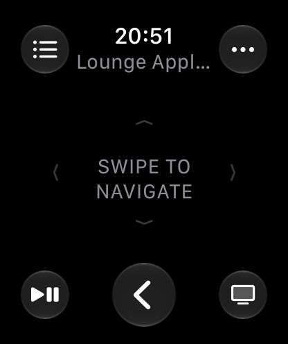

# Apple Watch remote for Home Assistant

A standalone watchOS 10+ SwiftUI app that talks to the same Home Assistant script used alongside [Glass Remote Card](../README.md). It is a companion to that card, not a replacement: swipe and tap to move around, turn the Digital Crown for volume, pick a player, see what’s playing, and dictate text into an on-screen field.

<sub>Not affiliated with or endorsed by Apple Inc. Apple Watch, Apple TV and the Apple Remote are trademarks of Apple Inc.</sub>

<p align="center">
  
</p>

The watch does not hard-code any device commands. Every press calls one HA script, `script.remote_button`, with `{button, text}`. Home Assistant then routes the press to the active Apple TV, Kodi or LG webOS player.

## What's here

| Path | What |
|---|---|
| `ha/remote_button_script.yaml` | Example HA script (`script.remote_button`). **Replace the example entity ids** before you load it. |
| `project.yml` | XcodeGen spec (one watchOS app target, no iPhone app) |
| `Support/Info.plist` | `WKApplication` / `WKWatchOnly`, plus ATS allowing plain-http LAN addresses |
| `WatchRemote/` | SwiftUI app, including the black-and-white remote app icon |
| `install-on-watch.sh` | Optional Mac helper: build and install. `TEAM` and `WATCH` must be set in the environment; there are no built-in defaults. |
| `Config/Secrets.example.xcconfig` | Optional build-time HA URL/token prefill. Copy to `Config/Secrets.xcconfig` (gitignored) and never commit the real file. |

## Using it on the watch

- **Main screen.** The whole screen is the touch surface, with no border. Swipe up, down, left or right to step, and tap anywhere to select. You get a haptic click each time, plus a soft glow where you tapped or a flash of the chevron on the side you swiped.
- The centre shows **now playing** (artwork, title, then episode, app or state). When nothing is playing it shows “SWIPE TO NAVIGATE”.
- Top-left **list** opens the device picker. Top-right **…** opens More. The device name sits under the clock.
- The bottom bar is **play/pause | back (large) | TV (home)**.
- Turn the **Digital Crown** for volume. Each detent sends one volume step, and quick spins are queued and capped at 8 steps. A green speaker and a +/− pill show by the crown while you turn it.
- **Typing.** When an Apple TV has a text field open, the centre becomes a **Type** button. Tap it to dictate or scribble; the text goes to the device through the script. The More menu can dictate on any player.
- **Devices** (list button): one card each for Auto and your configured players, with a tick on the current pick. The pick writes `input_select.remote_target` (a typical setup holds a manual pick for a few hours, then returns to Auto).
- **More** (…), a sheet with the system close button: Mute & Unmute, Captions, Power, skip, Info, Dictate, hold actions, volume buttons, and Settings.
- Home Assistant errors show in red in place of the device name, with an error haptic.

## 1. Home Assistant script

1. Open `ha/remote_button_script.yaml` and replace every example entity id with your own (`media_player.*`, `remote.*`, and optionally `media_player.lounge_avr` for volume). Keep those ids in sync with `WatchRemote/Models.swift`.
2. You also need:
   - `sensor.remote_player` — a template sensor whose state is the active `media_player` entity id.
   - `input_select.remote_target` — options are `auto` plus those same entity ids.
3. Load the script as a package under `/config/packages/`, or paste it into **Settings > Automations & scenes > Scripts**. Reload scripts (no restart needed).
4. Test from **Developer tools > Actions**, for example `script.remote_button` with `button: select`.

The script looks up an Apple TV config entry with `config_entry_id()` when sending text. If that comes back empty, paste the id from **Settings > Devices & services > Apple TV** (it appears in the URL) into the `atv_entry` variable instead. Do not commit real config entry ids if you fork this repository.

## 2. Long-lived access token

1. In Home Assistant, open your **profile** (bottom-left avatar), then the **Security** tab.
2. Under **Long-lived access tokens**, select **Create token** and give it a name such as “Apple Watch remote”.
3. Copy the token now; Home Assistant only shows it once. Paste it somewhere temporary on your iPhone, for example the clipboard.
4. To revoke it later, delete it in the same place.

The token has the full rights of your Home Assistant user. The app stores it only in the watch Keychain. It never leaves the watch except to your Home Assistant URL.

## 3. Build onto the watch (free Personal Team)

You need a Mac with Xcode 15 or later (watchOS 10 SDK; Xcode 16 or newer is fine), your iPhone paired with the watch, and a free Apple ID. There is no paid Apple Developer Program fee to sideload it this way.

```bash
brew install xcodegen            # free
cd watchos
# Change the placeholder bundle id in project.yml (and Keychain.swift) first
xcodegen generate
open WatchRemote.xcodeproj
```

1. In Xcode, go to **Settings > Accounts** and add your Apple ID. This creates a free “Personal Team”.
2. Select the **WatchRemote** target, then **Signing & Capabilities**:
   - Team: *your name (Personal Team)*.
   - The bundle id in `project.yml` is the placeholder `com.example.hawatchremote`. Change it to something unique before you build, and use the same string as the Keychain service in `WatchRemote/Keychain.swift`.
3. On the watch, go to **Settings > Privacy & Security > Developer Mode** and turn it on. The watch restarts. You may first need to connect it to Xcode once, through the iPhone, before the toggle appears.
4. Pick your Apple Watch as the run destination and press **Run** (⌘R). The first install over Wi-Fi can be slow.
5. If the app won't open, trust your developer profile on the watch: **Settings > General > VPN & Device Management**.
6. On the first launch, enter your Home Assistant URL (for example `https://homeassistant.example.com` or `http://homeassistant.local:8123`) and the token:
   - Tap the token field. Your iPhone shows an **Apple Watch Keyboard Input** notification.
   - Open it and paste the token there. Typing about 180 characters on the watch isn't practical.
   - Then tap **Test connection** in Settings.

**Free Personal Team limit:** the app stops launching after **7 days**. Re-run from Xcode (or `install-on-watch.sh`) with the watch nearby to reinstall; your settings and token survive. A free team is also limited to a few app ids per week.

A paid [Apple Developer Program](https://developer.apple.com/programs/) membership removes the 7-day expiry and allows TestFlight. That is optional and costs a yearly fee.

To install from the command line instead of the Xcode Run button, set your team id and watch UDID and run:

```bash
TEAM=<your-team-id> WATCH=<watch-udid> ./install-on-watch.sh
```

`xcrun devicectl list devices` prints the UDID. The script will not run without both variables; it has no built-in team or device values.

### Token prefill (optional)

To avoid typing the token on the watch, copy `Config/Secrets.example.xcconfig` to `Config/Secrets.xcconfig` (gitignored) with `HA_BASE_URL` and `HA_TOKEN`, then `xcodegen generate` and build. On first launch, if nothing is saved, the app copies them into UserDefaults and the Keychain once; Settings can still change or forget them. The token is then embedded in that build's Info.plist, so only install such builds on your own devices.

### Manual Xcode fallback (no XcodeGen)

1. In Xcode, choose File > New > Project > **watchOS > App**, named `WatchRemote`. Choose “Watch-only App”, Interface SwiftUI and deployment target watchOS 10.0.
2. Delete the generated `ContentView.swift` and `WatchRemoteApp.swift`. Drag in everything under `WatchRemote/` (Swift files, `Views/`, `Assets.xcassets`), with “Copy items if needed” ticked.
3. In the target's **Info** tab, add `App Transport Security Settings > Allows Local Networking = YES`. This is only needed if you use a plain-http LAN URL.
4. Sign with your Personal Team as above and Run.

## 4. Interim option: HA Companion Watch Actions (no Xcode)

The Home Assistant Companion app on the iPhone can put buttons on the watch that run a script. It costs nothing and needs no Xcode, but there is no Digital Crown volume and no touch pad.

1. Once `script.remote_button` is live, go to the iPhone HA app > **Settings > Companion App > Apple Watch** (called “Actions” on older versions).
2. Add one action per button. Each action runs `script.remote_button` with data such as `{"button": "play_pause"}`. Good choices are play_pause, select, back, home, volume_up, volume_down, mute, up and down.
3. Open the HA app on the watch to see them. They can also go in a watch complication.

## Notes

- Polling: every 3 s while the app is open (`sensor.remote_player`, `input_select.remote_target`, the active `media_player` and the Apple TV keyboard sensor). Nothing runs in the background.
- Network: the watch talks to Home Assistant directly, over Wi-Fi or cellular, or through the paired iPhone. Remote use needs your public HTTPS URL to be reachable.
- Dictation in More works for every device. The on-pad “Type” banner appears for players that have a keyboard-focus binary sensor configured in `Models.swift`.
- This folder is MIT-licensed with the rest of the repository. See [LICENSE](../LICENSE).
